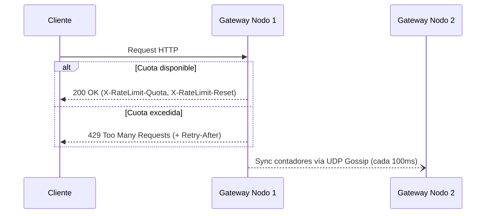

# Anexo 9 — Ejemplos few-shot de digest

> Anexo de la skill `dense-doc-digester`. Se consulta cuando hace falta fijar el formato exacto de salida.
> Los dos ejemplos son digests completos: uno en modo `technical` (spec de protocolo) y otro en `theoretical` (paper con matemáticas).

### Ejemplo 1: Modo `technical` (Digest de un extracto de RFC / Spec de protocolo)

**Entrada del usuario:**
> Digiere este documento técnico:
> *(Texto adjunto de una especificación interna `draft-ratelimit-token-v2.txt`: define un protocolo de control de tasa distribuido sobre HTTP. §1 Introducción comercial de 2 páginas sobre la historia de internet. §2 Terminología. §3 Cabeceras: `X-RateLimit-Quota` (entero obligatorio) y `X-RateLimit-Reset` (segundos UTC). §3.1 Regla normativa: "When a gateway receives a request exceeding Quota, it MUST return 429 Too Many Requests and SHOULD include a Retry-After header". §4 Algoritmo de sincronización eventual entre nodos cada 100ms mediante gossip UDP. En §4.2 menciona la constante `MAX_DRIFT_MS` pero no indica su valor por defecto en el texto).*

**Salida generada en `digests/draft-ratelimit-token-v2.md`:**
```markdown
---
title: "Especificación de Control de Tasa Distribuido (Token v2)"
source: "draft-ratelimit-token-v2.txt"
source_type: spec
date: 2026-10-21
status: unverified-claims
digest_mode: technical
lang_snippets: "http"
source_version: "v2-draft"
tags:
  - digest
  - rate-limiting
  - http-protocol
aliases:
  - "RateLimit Token v2"
---

## 1. TL;DR
Especificación de un protocolo de limitación de tasa (*rate limiting*) distribuido para pasarelas HTTP basado en sincronización eventual [fuente]. Define dos cabeceras principales de control (`X-RateLimit-Quota` y `X-RateLimit-Reset`) y el comportamiento normativo ante excesos de tráfico mediante respuestas `429` [fuente]. Los nodos del clúster sincronizan sus contadores cada `100ms` usando un protocolo *gossip* sobre UDP [fuente]. El borrador presenta una omisión crítica: referencia el parámetro `MAX_DRIFT_MS` sin definir su valor numérico [verificar: §4.2].

## 2. Qué problema resuelve / Tesis central
Resuelve la sobrecarga de coordinación síncrona en pasarelas HTTP distribuidas sustituyendo los bloqueos centralizados por un modelo de contadores locales sincronizados cada `100ms` vía UDP *gossip*, estandarizando las cabeceras de respuesta al cliente [fuente].

## 3. Mapa conceptual

[fuente]

## 4. Explicación progresiva
### Nivel 1 — Intuición base
Cada nodo de entrada lleva la cuenta del consumo del cliente e informa en cada respuesta cuánta cuota queda y cuándo se reinicia; si el cliente supera el límite, el nodo rechaza la petición con error `429` [fuente].

### Nivel 2 — Contrato de cabeceras y flujo HTTP
El servidor expone el estado del límite mediante dos cabeceras HTTP [fuente]:
- `X-RateLimit-Quota`: entero obligatorio con el límite asignado [fuente].
- `X-RateLimit-Reset`: tiempo en segundos UTC hasta el reinicio de la ventana [fuente].

### Nivel 3 — Sincronización entre nodos e implantación
Los nodos no bloquean cada petición consultando una base de datos central; propagan deltas de consumo cada `100ms` por UDP [fuente]. Debido a esta ventana de `100ms`, un cliente que distribuya peticiones en paralelo entre varios nodos puede superar momentáneamente su cuota antes de que converja el estado [inferencia: a partir del intervalo asíncrono de 100ms en §4].

```http
HTTP/1.1 429 Too Many Requests
X-RateLimit-Quota: 1000
X-RateLimit-Reset: 1792540800
Retry-After: 30
```
[contexto añadido: ejemplo de trama HTTP construido a partir de las reglas de §3 y §3.1]

## 5. Términos clave
- **Cuota de tasa** (*Quota*): Número máximo de peticiones permitidas dentro de una ventana temporal [fuente].
- **Cotilleo UDP** (*UDP Gossip*): Diseminación periódica de estado entre nodos sin coordinador central sobre datagramas UDP [fuente].

## 6. Detalles críticos que no se pueden perder
- **Cláusula normativa de rechazo:** *"When a gateway receives a request exceeding Quota, it MUST return 429 Too Many Requests and SHOULD include a Retry-After header"* — El código `429` es obligatorio (`MUST`), mientras que la cabecera `Retry-After` es una recomendación fuerte (`SHOULD`), no un requisito estricto para la validez del protocolo [fuente: §3.1].
- **Periodo de sincronización:** Fijado en `100ms` sobre transporte UDP (sin garantía nativa de entrega en capa de transporte) [fuente: §4].
- **Parámetro indefinido (`MAX_DRIFT_MS`):** El documento exige abortar la sincronización si el desfase de reloj supera `MAX_DRIFT_MS`, pero omite su valor por defecto o rango válido [verificar: comprobar si existe tabla de constantes en un anexo externo a §4.2].

## 7. Qué se ha omitido y por qué
- **Sección §1 (Introducción, pp. 1–2):** Omitida por contener únicamente historia general del tráfico web y motivación comercial sin impacto técnico en el protocolo.
- **Inconsistencia / Hueco en la fuente:** En `§4.2` se invoca la constante `MAX_DRIFT_MS` sin declararla previamente en `§2` ni en `§4`. No se ha asignado ningún valor supuesto.

## 8. Referencias exactas a la fuente por bloque
| Bloque del Digest | Ubicación en `draft-ratelimit-token-v2.txt` |
| :--- | :--- |
| §2 Tesis central | `§2`, `§4` |
| §4 Nivel 2 (Cabeceras) | `§3` |
| §4 Nivel 3 (Sincronización) | `§4`, `§4.2` |
| §6 Cláusula 429 / Retry-After | `§3.1` |
| §6 Constante `MAX_DRIFT_MS` | `§4.2` |
```

---

### Ejemplo 2: Modo `theoretical` (Digest de un Paper denso con matemáticas)

**Entrada del usuario:**
> `--mode auto --lang-snippets python`
> *(PDF adjunto `sparse-decay-attention-2026.pdf`, 12 páginas. §1 Introducción sobre LLMs. §2 Related Work (3 páginas de historia de Transformers). §3 Método: define un factor de atenuación exponencial por distancia $\gamma_{ij} = \exp(-\lambda \cdot \max(0, i - j - w))$ donde $w \in \mathbb{N}$ es la ventana local sin atenuación y $\lambda > 0$ la tasa de olvido. Asume secuencias causales ($i \ge j$). Demuestra en Teorema 1 (p. 6) que para $\lambda \ge \frac{\ln(N/\epsilon)}{L}$ el error de truncamiento en secuencias de longitud $N$ está acotado por $\epsilon$. No incluye código en el paper).*

**Salida generada en `digests/sparse-decay-attention-2026.md`:**
```markdown
---
title: "Atención Dispersa por Atenuación Exponencial con Ventana Local"
source: "sparse-decay-attention-2026.pdf"
source_type: paper
date: 2026-10-21
status: complete
digest_mode: theoretical
lang_snippets: "python"
source_version: "2026"
tags:
  - digest
  - attention-mechanism
  - transformers
aliases:
  - "Sparse Decay Attention"
---

## 1. TL;DR
El paper introduce un mecanismo de atención causal que conserva intactos los pesos dentro de una ventana local $w$ y aplica un decaimiento exponencial controlado por $\lambda$ a los tokens más lejanos [fuente]. Demuestra formalmente (Teorema 1) una cota inferior para $\lambda$ que permite truncar la matriz de atención garantizando un error de aproximación máximo $\epsilon$ [fuente].

## 2. Qué problema resuelve / Tesis central
Reduce el coste cuadrático de atender a todo el contexto histórico manteniendo exactitud total en el contexto inmediato (ventana $w$) y acotando matemáticamente el error al descartar tokens remotos cuya influencia decae exponencialmente [fuente].

## 3. Mapa conceptual
- **Distancia entre tokens ($i - j$)** [fuente]
  - Si $i - j \le w$ $\rightarrow$ Factor $\gamma_{ij} = 1$ (Atención estándar intacta) [fuente].
  - Si $i - j > w$ $\rightarrow$ Factor $\gamma_{ij} = \exp(-\lambda(i - j - w))$ (Atenuación exponencial) [fuente].
    - Si $\lambda \ge \frac{\ln(N/\epsilon)}{L}$ $\rightarrow$ Truncamiento seguro con error $\le \epsilon$ (Teorema 1) [fuente].

## 4. Explicación progresiva
### Nivel 1 — Intuición base
En lugar de tratar todos los tokens pasados por igual o cortarlos abruptamente, el modelo mira con nitidez total los últimos $w$ tokens y aplica una "niebla" progresiva a los tokens más antiguos según la tasa $\lambda$ [fuente].

### Nivel 2 — Formulación del factor de atenuación
Para una posición de consulta $i$ y una posición clave $j$ (con $i \ge j$), el peso de atención se multiplica por el coeficiente $\gamma_{ij}$ que vale $1$ cuando la distancia no supera $w$, y decae exponencialmente a partir de $w+1$ [fuente].

### Nivel 3 — Algoritmo de máscara e implantación
El paper no incluye código fuente; el siguiente snippet ilustra vectorialmente la ecuación de `§3` para facilitar su comprensión [contexto añadido]:

```python
# [contexto añadido: implementación ilustrativa en Python de la Ec. de §3, p. 4]
import numpy as np

def compute_gamma_mask(seq_len: int, w: int, lam: float) -> np.ndarray:
    i = np.arange(seq_len)[:, None]
    j = np.arange(seq_len)[None, :]
    excess_dist = np.maximum(0, i - j - w)
    gamma = np.exp(-lam * excess_dist)
    return np.tril(gamma)  # causalidad: i >= j
```

## 5. Términos clave
- **Ventana local exenta** (*Local Window*, $w$): Número de posiciones inmediatamente anteriores a $i$ que no sufren penalización exponencial [fuente].
- **Tasa de olvido** (*Decay Rate*, $\lambda$): Hiperparámetro escalar positivo ($\lambda > 0$) que controla la velocidad de caída fuera de la ventana $w$ [fuente].

## 6. Detalles críticos que no se pueden perder
- **Ecuación de atenuación exacta:**
  $$\gamma_{ij} = \exp\big(-\lambda \cdot \max(0, i - j - w)\big)$$
  donde $w \in \mathbb{N}$ y $\lambda > 0$ [fuente: §3, p. 4].
- **Supuesto de causalidad estricto:** Toda la derivación asume atención autorregresiva causal ($i \ge j$). No es aplicable directamente a codificadores bidireccionales sin redefinir $i - j$ como $\vert{}i - j\vert{}$ [fuente: §3, p. 4] [inferencia: extensión a $\vert{}i-j\vert{}$ deducida de la restricción $i \ge j$].
- **Cota del Teorema 1 (Truncamiento con error acotado):** Para garantizar que el error de truncamiento a distancia $L$ en una secuencia de longitud $N$ no supere $\epsilon$, se debe cumplir:
  $$\lambda \ge \frac{\ln(N/\epsilon)}{L}$$
  [fuente: §3, Teorema 1, p. 6].

## 7. Qué se ha omitido y por qué
- **Sección §1 (pp. 1–2):** Motivación general sobre el crecimiento del mercado de LLMs.
- **Sección §2 (*Related Work*, pp. 2–4):** Revisión histórica de arquitecturas Transformer previas desde 2017 que no intervienen en la formulación ni en las cotas del método propuesto.

## 8. Referencias exactas a la fuente por bloque
| Bloque del Digest | Ubicación en `sparse-decay-attention-2026.pdf` |
| :--- | :--- |
| §2 Tesis central | `§1 (p. 2)`, `§3 (p. 4)` |
| §4 Nivel 2 (Factor $\gamma_{ij}$) | `§3, p. 4` |
| §6 Ecuación $\gamma_{ij}$ y supuestos | `§3, p. 4` |
| §6 Teorema 1 (Cota de $\lambda$) | `§3, p. 6` |
```

---
