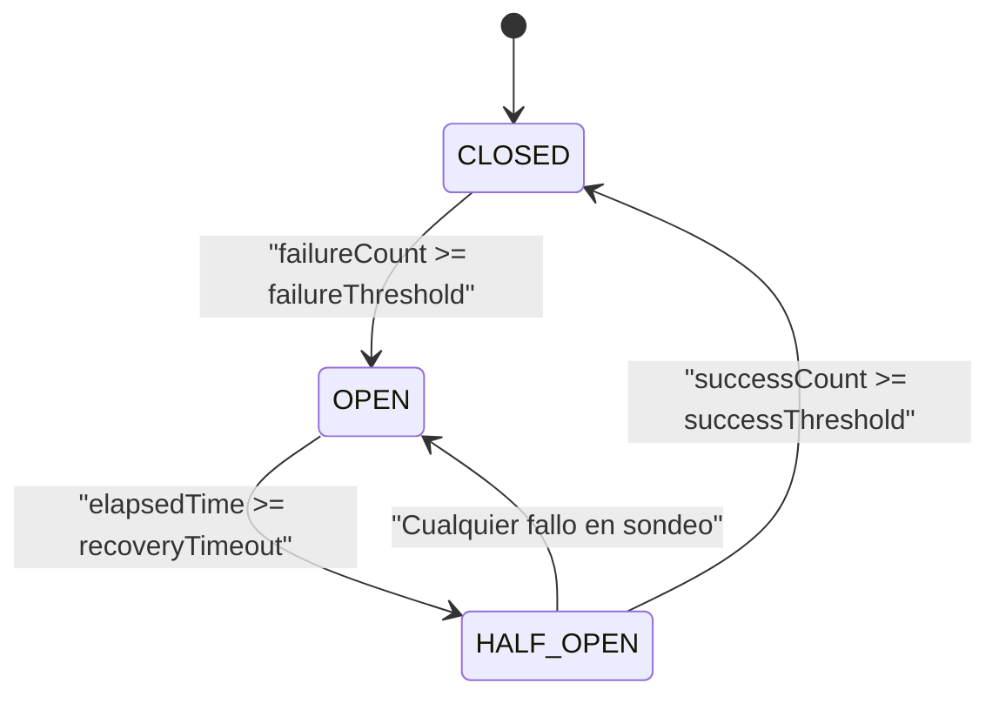

# Ejemplos Few-Shot de `tech-notes-generator` (`EXAMPLES.md`)

Este archivo complementa a `SKILL.md` y muestra la ejecución exacta esperada en **3 escenarios canónicos**:
1. **Caso 1 (`--concept` + Concepto denso pequeño):** Patrón *Circuit Breaker* (con atajo de nivel directo, pseudosnippets agnósticos, Mermaid de estados y omisión justificada de secciones).
2. **Caso 2 (`--url` + Tecnología grande):** Librería/herramienta (`SQLite` desde su URL de CLI) con flujo en 2 pasos (selector de nivel 1–5 → generación completa con las 9 secciones, SQL + CLI).
3. **Caso 3 (Activación de guardias de parada):** Respuestas obligatorias ante fallo de lectura de `--url`, concepto ambiguo, colisión sin `--force` y frontera con `dense-doc-digester`.

---

## Caso 1: `--concept` sobre un Concepto Denso Pequeño (con nivel indicado en el prompt)

### Entrada del usuario
> `--concept "Circuit Breaker" --force` (nivel 3: entiendo la teoría, quiero implementarlo desde cero)

### Salida del modelo (`tech-notes/circuit-breaker.md`)

```markdown
---
title: "Patrón Circuit Breaker: Uso e Implementación desde Cero"
technology: "Circuit Breaker Pattern"
version: "unversioned"
---

## 1. TL;DR

El patrón **Circuit Breaker** (disyuntor) es un mecanismo de estabilidad para llamadas a servicios remotos o recursos externos propensos a fallos. Envuelve cada operación en una máquina de estados que monitoriza los errores recientes y, cuando estos superan un umbral configurado, bloquea temporalmente nuevas llamadas devolviendo un error inmediato (*fail-fast*) sin esperar timeouts de red. Se utiliza para evitar fallos en cascada en sistemas distribuidos y dar tiempo de recuperación al servicio degradado.

> **Secciones omitidas:** `Instalación / setup` *(no aplica por tratarse de un patrón de diseño de software sin paquete ni binario propio instalable)*.

---

## 2. Requisitos previos

- Comprensión del modelo de petición/respuesta en llamadas de red y del concepto de *timeout*.
- Manejo de excepciones o retorno de errores y control de marcas de tiempo (*timestamps*) monotónicas.

---

## 4. Conceptos clave

El patrón funciona como un proxy intermedio gobernado por tres estados mutuamente excluyentes y tres umbrales numéricos:

- **Estados del disyuntor:**
  1. **`CLOSED` (Cerrado — flujo normal):** Las peticiones pasan hacia el servicio remoto. Si una llamada falla, se incrementa `failureCount`. Al alcanzar `failureThreshold`, el estado cambia a `OPEN`.
  2. **`OPEN` (Abierto — bloqueo preventivo):** Ninguna petición llega al servicio remoto; todas se rechazan al instante o ejecutan una respuesta alternativa (*fallback*). Al iniciarse este estado se registra el instante de apertura. Cuando transcurre el tiempo `recoveryTimeout`, pasa a `HALF_OPEN`.
  3. **`HALF_OPEN` (Semiabierto — sondeo de recuperación):** Permite el paso de un número muy limitado de peticiones de prueba (`halfOpenMaxCalls`). Si tienen éxito, el sistema asume que el servicio externo se ha recuperado, reinicia los contadores y vuelve a `CLOSED`. Si cualquiera de las pruebas falla, regresa inmediatamente a `OPEN`.



---

## 5. Cheatsheet

| Parámetro / Método | Propósito técnico | Valor orientativo de partida |
| :--- | :--- | :--- |
| `failureThreshold` | Fallos consecutivos necesarios para abrir el circuito | `3` a `10` fallos |
| `recoveryTimeout` | Tiempo de espera en estado `OPEN` antes de probar `HALF_OPEN` | `10s` a `60s` |
| `successThreshold` | Éxitos consecutivos en `HALF_OPEN` para volver a `CLOSED` | `1` a `3` éxitos |
| `execute(action)` | Envía la operación si el estado lo permite y actualiza contadores | — |
| `recordSuccess()` | Reinicia `failureCount` o avanza la transición desde `HALF_OPEN` | — |
| `recordFailure()` | Incrementa `failureCount` o reabre inmediatamente desde `HALF_OPEN` | — |

---

## 6. Snippets progresivos

> ℹ️ **Nota sobre los snippets:** Los siguientes bloques son estáticos y tienen fines didácticos. No se garantiza su ejecución directa sin adaptar rutas, variables de entorno, dependencias o versiones a tu entorno local.

### Paso 1: Estructura de estado y configuración base (Pseudosnippet)
Este bloque define la estructura de datos mínima que mantiene los contadores internos, los umbrales de transición y la marca temporal del último fallo.

```text
// Definición de estados posibles del disyuntor
ENUM State { CLOSED, OPEN, HALF_OPEN }

CLASS CircuitBreaker {
    // Parámetros de configuración inmutables
    PROPERTY failureThreshold: Integer
    PROPERTY recoveryTimeoutMs: Integer
    PROPERTY successThreshold: Integer

    // Estado mutable interno
    PROPERTY currentState: State = State.CLOSED
    PROPERTY failureCount: Integer = 0
    PROPERTY successCount: Integer = 0
    PROPERTY openedAtMs: Integer = 0

    CONSTRUCTOR(failureThreshold, recoveryTimeoutMs, successThreshold) {
        THIS.failureThreshold = failureThreshold
        THIS.recoveryTimeoutMs = recoveryTimeoutMs
        THIS.successThreshold = successThreshold
    }
}
```

### Paso 2: Lógica de evaluación previa a la llamada (`canExecute`)
Antes de invocar el recurso remoto, el disyuntor comprueba si debe bloquear la llamada o si ya ha expirado el temporizador de enfriamiento para pasar de `OPEN` a `HALF_OPEN`.

```text
METHOD canExecute(nowMs: Integer) -> Boolean {
    IF THIS.currentState == State.CLOSED {
        RETURN True
    }

    IF THIS.currentState == State.OPEN {
        // Verifica si ya transcurrió el tiempo de espera para sondear
        elapsedMs = nowMs - THIS.openedAtMs
        IF elapsedMs >= THIS.recoveryTimeoutMs {
            THIS.currentState = State.HALF_OPEN
            THIS.successCount = 0
            RETURN True
        }
        RETURN False
    }

    // En estado HALF_OPEN se permite el paso de la llamada de prueba
    RETURN True
}
```

### Paso 3: Ejecución completa con registro de éxitos, fallos y *fallback*
Este bloque integra la evaluación previa, la ejecución de la llamada protegida y la actualización de la máquina de estados según el resultado obtenido.

```text
METHOD execute(remoteCall: Function, fallbackCall: Function, nowMs: Integer) -> Result {
    // 1. Rechazo rápido si el circuito sigue abierto
    IF NOT THIS.canExecute(nowMs) {
        RETURN fallbackCall("CircuitOpenError")
    }

    // 2. Intento de ejecución de la operación remota
    TRY {
        response = remoteCall()
        THIS.onSuccess()
        RETURN response
    } CATCH (networkOrServerError) {
        THIS.onFailure(nowMs)
        RETURN fallbackCall(networkOrServerError)
    }
}

METHOD onSuccess() -> Void {
    IF THIS.currentState == State.HALF_OPEN {
        THIS.successCount = THIS.successCount + 1
        IF THIS.successCount >= THIS.successThreshold {
            // El servicio remoto respondió establemente; se cierra el circuito
            THIS.currentState = State.CLOSED
            THIS.failureCount = 0
            THIS.successCount = 0
        }
    } ELSE {
        // Reinicia el contador de fallos consecutivos en flujo normal
        THIS.failureCount = 0
    }
}

METHOD onFailure(nowMs: Integer) -> Void {
    IF THIS.currentState == State.HALF_OPEN {
        // Un solo fallo durante el sondeo devuelve el circuito a OPEN
        THIS.currentState = State.OPEN
        THIS.openedAtMs = nowMs
        RETURN
    }

    THIS.failureCount = THIS.failureCount + 1
    IF THIS.failureCount >= THIS.failureThreshold {
        THIS.currentState = State.OPEN
        THIS.openedAtMs = nowMs
    }
}
```

---

## 7. Gotchas / errores comunes

- **Contabilizar errores de cliente (4xx) como fallos del circuito:**
  - **Causa técnica:** Si una petición devuelve `400 Bad Request` o `404 Not Found`, el servidor remoto está operativo; el fallo está en los datos enviados. Si el disyuntor cuenta ese error, abrirá el circuito por culpa de entradas inválidas.
  - **Solución correcta:** Filtra las excepciones para que `onFailure` solo se active ante errores de red, *timeouts* o fallos del servidor (`5xx`).
- **Estampida de peticiones en estado `HALF_OPEN`:**
  - **Causa técnica:** Cuando vence `recoveryTimeoutMs` en un sistema con alta concurrencia, decenas de hilos pueden ver el paso a `HALF_OPEN` al mismo tiempo y saturar de nuevo el servicio recién recuperado.
  - **Solución correcta:** Utiliza un bloqueo atómico (*mutex* o contador atómico `inFlightProbes`) para permitir que únicamente 1 petición (o hasta `successThreshold` peticiones simultáneas) atraviese el estado `HALF_OPEN`, rechazando el resto mientras dura el sondeo.
- **Usar Circuit Breaker sin configurar *timeout* en el cliente de red:**
  - **Causa técnica:** Si el cliente de red tiene un *timeout* infinito o de varios minutos, las llamadas quedarán colgadas antes de que el disyuntor pueda registrar el primer fallo.
  - **Solución correcta:** Configura siempre un *timeout* corto y explícito en cada llamada remota envuelta por el disyuntor.

---

## 8. Glosario

- **Fail-fast:** Propiedad de abortar inmediatamente una operación condenada a fallar sin consumir recursos de espera.
- **Fallback:** Respuesta alternativa segura (dato en caché, valor por defecto o error degradado) que se entrega cuando el circuito está en `OPEN`.
- **Cascading Failure (Fallo en cascada):** Efecto dominó donde la lentitud de un servicio agota los hilos o conexiones de los servicios que dependen de él.

---

## 9. Recursos

- Documentación arquitectónica del patrón Circuit Breaker (Microsoft Cloud Design Patterns): `[https://learn.microsoft.com/en-us/azure/architecture/patterns/circuit-breaker](https://learn.microsoft.com/en-us/azure/architecture/patterns/circuit-breaker)`
- Descripción original del patrón por Martin Fowler: `[https://martinfowler.com/bliki/CircuitBreaker.html](https://martinfowler.com/bliki/CircuitBreaker.html)`
```

---

## Caso 2: `--url` sobre una Tecnología Grande (Flujo en 2 turnos con selector de nivel)

### Turno 1 — Entrada del usuario (sin especificar nivel)
> `--url https://sqlite.org/cli.html`

### Turno 1 — Respuesta del modelo (Selector de nivel 1 a 5)
```markdown
He preparado la estructura para **`SQLite CLI`** (`tech-notes/sqlite-cli.md`):
- **Clasificación detectada:** `Tecnología grande` *(dime si prefieres cambiarla)*.

¿Qué **nivel de dominio (1 a 5)** tienes sobre este concepto o derivados para ajustar la profundidad?
- **1 — Nulo (Desde cero absoluto):** No conozco el concepto ni herramientas similares. Explicar modelo mental desde cero y cada paso sin asumir jerga.
- **2 — Nociones sueltas (Principiante):** ⭐ **Recomendado por defecto.** Sé qué problema ataca o conozco herramientas parecidas, pero nunca lo he usado. Foco en setup guiado, anatomía básica y primeros pasos claros.
- **3 — Base teórica sin práctica (Intermedio):** Entiendo la teoría, pero necesito implementarlo de verdad. Menos introducción conceptual y más configuración, flujo real y código comentado.
- **4 — Uso básico previo (Práctico):** Ya he hecho pruebas simples; busco estructurarlo bien, patrones idiomáticos, casos compuestos y evitar errores comunes.
- **5 — Uso práctico / Refresco (Avanzado):** Ya lo he usado pero necesito repasar sintaxis y detalles clave. Directo al grano: TL;DR, Cheatsheet, snippets complejos y gotchas críticos.
```

### Turno 2 — Respuesta del usuario
> 2

### Turno 2 — Salida del modelo (`tech-notes/sqlite-cli.md`)

```markdown
---
title: "SQLite CLI: Uso Práctico e Implementación desde Cero"
technology: "SQLite"
version: "3.x"
---

## 1. TL;DR

**SQLite** es un motor de base de datos relacional transaccional que almacena toda la base de datos (tablas, índices, disparadores y datos) en un único archivo de disco multiplataforma, sin requerir un proceso de servidor separado. Su interfaz de línea de comandos (`sqlite3`) permite crear bases de datos, ejecutar consultas SQL, importar/exportar archivos (como CSV o volcados SQL) e inspeccionar esquemas directamente desde la terminal. Se usa para almacenamiento local de aplicaciones, análisis rápido de datos, prototipado y pruebas automatizadas.

> **Secciones omitidas:** `Ninguna`.

---

## 2. Requisitos previos

- Manejo básico de la terminal del sistema operativo (navegación de directorios y redirección de archivos).
- Nociones elementales de tablas relacionales (filas, columnas y clave primaria).

---

## 3. Instalación / setup

El binario de consola se invoca como `sqlite3`.

```bash
# Verificar si sqlite3 ya está instalado en el sistema y consultar su versión
sqlite3 --version

# Instalación en Debian / Ubuntu
sudo apt-get update && sudo apt-get install -y sqlite3

# Instalación en macOS mediante Homebrew
brew install sqlite
```

Para abrir o crear una base de datos en un archivo local llamado `app_data.db`:

```bash
# Si el archivo no existe, lo crea al escribir la primera tabla
sqlite3 app_data.db
```

---

## 4. Conceptos clave

1. **Base de datos en archivo único vs. en memoria:** Al pasar una ruta (`sqlite3 app_data.db`), los cambios persisten en ese archivo. Si se ejecuta `sqlite3` sin argumentos o con `:memory:`, la base de datos vive únicamente en memoria RAM y desaparece al cerrar la sesión.
2. **Sentencias SQL vs. Dot-commands (comandos punto):**
   - **Sentencias SQL:** Consultas estándar (`SELECT`, `CREATE TABLE`, `INSERT`) que **siempre deben terminar en punto y coma (`;`)** para ejecutarse.
   - **Dot-commands:** Comandos propios de la consola `sqlite3` que **empiezan por un punto (`.`)**, no llevan punto y coma al final y sirven para configurar el formato de salida o inspeccionar metadatos (ej. `.tables`, `.schema`, `.mode`).
3. **Directivas `PRAGMA`:** Instrucciones especiales de SQLite para consultar o modificar el comportamiento interno del motor en tiempo de ejecución (como activar la validación de claves foráneas o cambiar el modo de escritura concurrente).

---

## 5. Cheatsheet

| Comando / Directiva | Tipo | Efecto exacto |
| :--- | :--- | :--- |
| `.help` | Dot-command | Muestra la lista de comandos de consola disponibles |
| `.tables` | Dot-command | Lista todas las tablas existentes en la base de datos abierta |
| `.schema [table_name]` | Dot-command | Muestra la sentencia `CREATE` exacta de la base de datos o de una tabla |
| `.mode box` / `.mode csv` | Dot-command | Cambia la visualización de resultados a tabla con bordes o formato CSV |
| `.headers on` | Dot-command | Muestra los nombres de las columnas en la salida de las consultas |
| `.read <file.sql>` | Dot-command | Ejecuta todas las sentencias SQL contenidas en un archivo externo |
| `.quit` / `.exit` | Dot-command | Cierra la sesión de `sqlite3` de forma segura |
| `PRAGMA foreign_keys = ON;` | SQL Pragma | Activa la comprobación de integridad de claves foráneas en la conexión actual |

---

## 6. Snippets progresivos

> ℹ️ **Nota sobre los snippets:** Los siguientes bloques son estáticos y tienen fines didácticos. No se garantiza su ejecución directa sin adaptar rutas, variables de entorno, dependencias o versiones a tu entorno local.

### Paso 1: Creación de esquema, inserción y formato legible
Este bloque activa las cabeceras y el formato de tabla en consola, crea una tabla `users` con restricciones explícitas, inserta dos registros y los consulta.

```sql
-- Configuración visual de la sesión en la consola sqlite3
.headers on
.mode box

-- Creación de la tabla con clave primaria autoincremental y restricción de unicidad
CREATE TABLE IF NOT EXISTS users (
    user_id INTEGER PRIMARY KEY,
    email TEXT NOT NULL UNIQUE,
    created_at TEXT NOT NULL DEFAULT CURRENT_TIMESTAMP
);

-- Inserción de datos de prueba
INSERT INTO users (email) VALUES ('alice@example.com');
INSERT INTO users (email) VALUES ('bob@example.com');

-- Consulta de verificación
SELECT user_id, email, created_at FROM users;
```

### Paso 2: Relaciones con claves foráneas y transacciones explícitas
Por defecto, SQLite tiene desactivada la validación de claves foráneas por compatibilidad histórica. Este bloque la habilita con `PRAGMA` y envuelve múltiples operaciones en una transacción atómica (`BEGIN TRANSACTION` ... `COMMIT`).

```sql
-- Obligatorio en cada nueva conexión para hacer cumplir las claves foráneas
PRAGMA foreign_keys = ON;

CREATE TABLE IF NOT EXISTS orders (
    order_id INTEGER PRIMARY KEY,
    user_id INTEGER NOT NULL,
    total_cents INTEGER NOT NULL CHECK (total_cents >= 0),
    FOREIGN KEY (user_id) REFERENCES users (user_id) ON DELETE CASCADE
);

-- Transacción atómica: o se aplican todos los cambios o ninguno
BEGIN TRANSACTION;
INSERT INTO orders (user_id, total_cents) VALUES (1, 2500);
INSERT INTO orders (user_id, total_cents) VALUES (1, 4990);
COMMIT;

-- Consulta combinada de usuarios y sus pedidos
SELECT u.email, o.order_id, o.total_cents
FROM users AS u
INNER JOIN orders AS o ON u.user_id = o.user_id;
```

### Paso 3: Automatización no interactiva desde terminal e importación/exportación CSV
Para integrar `sqlite3` en scripts de automatización sin entrar al modo interactivo, se pasan comandos como argumentos o mediante redirección estándar.

```bash
# 1. Ejecutar una consulta directamente desde bash y guardar el resultado en CSV
sqlite3 -header -csv app_data.db "SELECT user_id, email FROM users;" > exported_users.csv

# 2. Importar un archivo CSV existente hacia una nueva tabla llamada imported_logs
sqlite3 app_data.db ".mode csv" ".import raw_logs.csv imported_logs"

# 3. Generar una copia de seguridad completa en texto SQL (dump)
sqlite3 app_data.db ".dump" > backup_schema_and_data.sql
```

---

## 7. Gotchas / errores comunes

- **Quedarse atrapado en el prompt de continuación `...> `:**
  - **Causa técnica:** Olvidar el punto y coma (`;`) al final de una sentencia SQL hace que `sqlite3` espere más líneas de la misma consulta. Asimismo, poner un `;` por error después de un dot-command provoca errores de comando desconocido.
  - **Solución correcta:** Escribe `;` y pulsa `Enter` para cerrar la sentencia pendiente (o escribe `';` / `";` si dejaste una comilla abierta).
- **Las claves foráneas (`FOREIGN KEY`) se definen pero no lanzan error al insertar IDs huérfanos:**
  - **Causa técnica:** `PRAGMA foreign_keys` está en `OFF` por defecto al abrir cada sesión de conexión.
  - **Solución correcta:** Ejecuta siempre `PRAGMA foreign_keys = ON;` al inicio de cada sesión o script antes de insertar o borrar filas.
- **Tipado flexible en columnas (manifest typing):**
  - **Causa técnica:** Salvo que una tabla se declare como `STRICT`, SQLite usa afinidad de tipos y permite guardar un texto como `'abc'` dentro de una columna declarada como `INTEGER` si no puede convertirlo.
  - **Solución correcta:** Si requieres validación estricta de tipos de columna a nivel de motor (versión 3.37.0+), añade la palabra clave `STRICT` al final de la sentencia `CREATE TABLE (... ) STRICT;`.

---

## 8. Glosario

- **Dot-command:** Comando administrativo exclusivo del cliente de consola `sqlite3` precedido por un punto (`.`).
- **PRAGMA:** Sentencia específica de SQLite utilizada para configurar parámetros internos del motor o consultar metadatos de la base de datos.
- **Type Affinity (Afinidad de tipos):** Regla por la cual SQLite recomienda un tipo de almacenamiento para una columna pero permite almacenar valores de otros tipos salvo en tablas `STRICT`.

---

## 9. Recursos

- Documentación oficial de la interfaz de línea de comandos de SQLite: `[https://sqlite.org/cli.html](https://sqlite.org/cli.html)`
- Documentación general y referencia SQL de SQLite: `[https://sqlite.org/docs.html](https://sqlite.org/docs.html)`
- Ayuda integrada local en consola: ejecutar `sqlite3` y escribir `.help`.
```

---

## Caso 3: Activación de Guardias de Parada (Sin inventar contenido)

### 3A. Guardia ante `--url` con lectura fallida (Paywall / JS / 404 / Sin red)
**Entrada del usuario:**
> `--url https://internal-corp-docs.example.com/private-framework/setup`

**Salida obligatoria del modelo:**
```markdown
**No ha sido posible extraer el contenido de `[https://internal-corp-docs.example.com/private-framework/setup](https://internal-corp-docs.example.com/private-framework/setup)`** *(motivo: el enlace no es accesible públicamente o devuelve error de conexión/autenticación)*. ¿Cómo prefieres continuar?
- **A)** Pegar directamente aquí el texto o fragmento relevante de la página.
- **B)** Proporcionar otra URL pública accesible o usar `--concept <nombre>` basándonos en el conocimiento general verificado de la tecnología.
- **C)** Abortar la generación.
```

---

### 3B. Guardia ante `--concept` ambiguo
**Entrada del usuario:**
> `--concept Flux`

**Salida obligatoria del modelo:**
```markdown
El término **`Flux`** es ambiguo y corresponde a varias tecnologías distintas. ¿Sobre cuál de ellas quieres generar la nota técnica?
- **A)** **Arquitectura Flux (Meta/Facebook):** Patrón de flujo de datos unidireccional para aplicaciones de interfaz de usuario.
- **B)** **Flux CD (CNCF):** Herramienta de entrega continua y GitOps para clústeres de Kubernetes.
- **C)** **Flux (InfluxData):** Lenguaje funcional de scripting y consulta de datos para series temporales en InfluxDB.
- **D)** **Flux.jl:** Librería de aprendizaje automático en el lenguaje Julia.
- **E)** Otra (especificar).
```

---

### 3C. Guardia ante colisión de archivo existente sin `--force`
**Entrada del usuario:**
> `--concept "Circuit Breaker"` *(cuando `tech-notes/circuit-breaker.md` ya existe en el proyecto)*

**Salida obligatoria del modelo:**
```markdown
El archivo **`tech-notes/circuit-breaker.md`** ya existe en el directorio de destino y la regla de idempotencia impide sobrescribirlo por defecto. ¿Cómo deseas proceder?
- **A)** Sobrescribir el archivo existente ejecutando la petición con el flag `--force`.
- **B)** Generar la nota bajo un concepto más específico que produzca otro `<slug>`.
- **C)** Abortar la operación y conservar el archivo actual.
```

---

### 3D. Guardia de frontera con `dense-doc-digester` (Paper / RFC concreto)
**Entrada del usuario:**
> `--url https://datatracker.ietf.org/doc/html/rfc9110 — Hazme un resumen fiel de este RFC sección por sección sin añadir nada de fuera.`

**Salida obligatoria del modelo:**
```markdown
Para digerir un documento concreto (paper, RFC o especificación) manteniendo fidelidad estricta a la fuente sin conocimiento externo, utiliza la skill `dense-doc-digester`.

Si en cambio deseas una guía práctica general para aprender a usar e implementar el protocolo **HTTP Semantics** desde cero combinando explicaciones didácticas y ejemplos externos, indícamelo y lo procesaremos con `tech-notes-generator`.
```